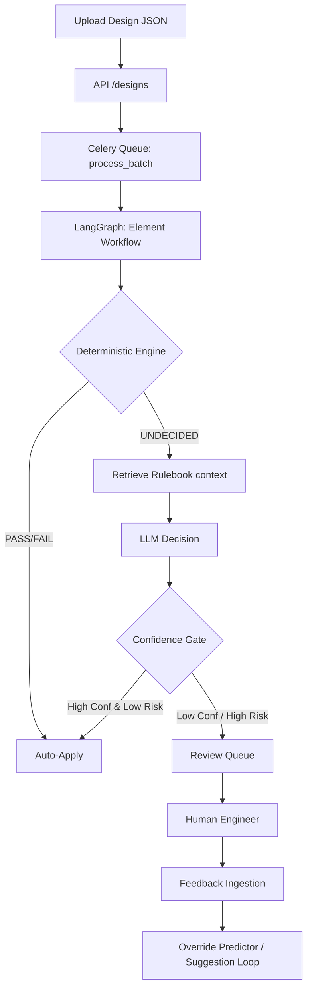

# RuleForge

RuleForge is a production-style, multi-tenant AI agent platform that reviews MEP (Mechanical, Electrical, Plumbing) designs against codified rules. 

A deterministic engine decides everything possible, falling back to an LLM for ambiguity, with a human-in-the-loop feedback pipeline for continuous learning.

## Architecture



## Quick Start

The platform requires Python 3.11. To run the full stack (API, UI, Celery, Postgres with pgvector, Redis) easily, use Docker:

1. Clone the repository.
2. Build and start the stack:
   ```bash
   make up
   # or docker-compose up -d --build
   ```
3. Generate synthetic sample data (optional):
   ```bash
   make gen-data
   # Generates sample designs to data/designs and eval labels
   ```
4. Access the Dashboard at: `http://localhost:5000/`
5. Access the API at: `http://localhost:5000/api/v1/docs`

## Evaluation

To run the offline evaluation harness against the generated labels:
```bash
python eval/run_eval.py --mode rules_mock
```
See `docs/EVALUATION.md` for complete findings and limits.

## Project Structure
- `app/engine`: Deterministic rule evaluator and rule definitions.
- `app/graph`: LangGraph workflows.
- `app/llm`: Provider abstractions (Mock, Anthropic, Ollama, OpenAI) and Confidence Gate.
- `app/feedback`: Continuous learning loop components.
- `generator`: Scripts to generate synthetic MEP json designs.
- `docker`: Container setup with Python 3.11 for accurate type parsing and `pgvector`.
